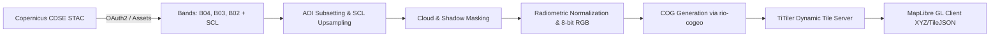

# MemoryLane-Satellite Pipeline Architecture

## 1. Executive Summary

`MemoryLane-Satellite` is an independent, self-hosted, zero-cost satellite imagery pipeline designed to query, ingest, process, and serve Sentinel-2 L2A multispectral imagery as Cloud Optimized GeoTIFFs (COG) to MapLibre-based frontends.

The pipeline is completely decoupled from any commercial APIs (e.g., Google Earth Engine commercial tier, Sentinel Hub paid subscriptions, Planet, Mapbox satellite). It operates using open data from the European Space Agency's Copernicus programme via the Copernicus Data Space Ecosystem (CDSE) and open-source geospatial software.



---

## 2. Target Area of Interest (AOI): Manali–Solang Valley

* **Geographic Extent:** Himachal Pradesh, Western Himalayas, India.
* **Approximate Coordinates (BBOX):** `[77.05, 32.15, 77.30, 32.38]` (WGS84 EPSG:4326).
* **Ground Coverage:** ~18 km x 25 km covering Manali town, Solang Valley, Rohtang foothills, and the Beas river basin.
* **Projected CRS:** UTM Zone 43N (`EPSG:32643`).
* **Himalayan Geospatial Challenges:**
  * **Steep Mountain Topography:** Deep valley shadows require careful contrast stretching.
  * **Snow vs. Cloud Discrimination:** High-altitude ridges feature perennial or seasonal snow. Naive brightness thresholding misclassifies snow as clouds. Sentinel-2 L2A's Scene Classification Layer (SCL) explicitly separates snow (class 11) from clouds (classes 8, 9, 10).
  * **Seasonal Cloud Cover:** Optimal scenes are selected from post-monsoon autumn windows (mid-September to late October) when cloud cover is lowest and atmospheric transparency is highest.

---

## 3. Data Source: Copernicus Data Space Ecosystem (CDSE)

### 3.1 Overview
The European Space Agency transitioned open Sentinel distribution to the Copernicus Data Space Ecosystem (CDSE). CDSE provides STAC (SpatioTemporal Asset Catalog) discovery and REST/S3 direct asset retrieval.

* **STAC Endpoint:** `https://stac.dataspace.copernicus.eu/v1`
* **Collection:** `sentinel-2-l2a` (Bottom-Of-Atmosphere Surface Reflectance, geometrically orthorectified and atmospherically corrected).
* **Authentication:** OAuth2 OpenID Connect token exchange with `client_id=cdse-public`.

### 3.2 Sentinel-2 L2A Band Specification & Targeted Ingestion

Instead of downloading the entire 1 GB+ `.SAFE` zip container, our pipeline queries STAC asset links and selectively downloads only the 4 required rasters:

| Band / Asset Key | Description | Native Spatial Resolution | Spectral Range | Pipeline Purpose |
| :--- | :--- | :--- | :--- | :--- |
| **`B04`** | Red | 10 meters | 665 nm | RGB Composite (Channel 1) |
| **`B03`** | Green | 10 meters | 560 nm | RGB Composite (Channel 2) |
| **`B02`** | Blue | 10 meters | 490 nm | RGB Composite (Channel 3) |
| **`SCL`** | Scene Classification Layer | 20 meters | Discrete Quality Mask | Cloud & Cloud-Shadow Masking |
| *`B08`* | *Near Infrared (NIR)* | *10 meters* | *842 nm* | *(Optional: Vegetation & Water Index validation)* |

---

## 4. Processing Pipeline Details

### Step 1: Search & Scene Selection (`scripts/search_scenes.py`)
* Queries CDSE STAC `/search` with AOI polygon, date range, and maximum cloud cover limit (`eo:cloud_cover <= 20%`).
* Evaluates coverage overlap with the target AOI.
* Selects the granule with optimal quality and minimal snow/cloud occlusion.

### Step 2: Selective Band Download (`scripts/download_sentinel.py`)
* Exchanges CDSE user credentials for a Bearer JWT token.
* Downloads only `B04`, `B03`, `B02`, and `SCL` single-band rasters to `data/raw/<scene_id>/`.

### Step 3: Cloud Masking & RGB Composite (`processing/build_composite.py`)
1. **AOI Subsetting (Window Read):** Reads only the bounding box region from each 100 km x 100 km granule to conserve RAM.
2. **SCL Resampling:** Upsamples the 20m SCL raster to 10m to match the grid of `B04`, `B03`, and `B02` using nearest-neighbor interpolation to preserve discrete integer class values.
3. **SCL Class Filtering:**
   * **Masked Classes:**
     * `3` = Cloud Shadows
     * `8` = Cloud Medium Probability
     * `9` = Cloud High Probability
     * `10` = Thin Cirrus
     * `0` = No Data
   * **Preserved Classes:**
     * `4` = Vegetation
     * `5` = Not-vegetated (bare soil/rock)
     * `6` = Water
     * `11` = Snow / Ice (crucial for Solang Valley mountain passes)
4. **Radiometric Calibration & Color Stretching:**
   * Sentinel-2 L2A DN values represent surface reflectance multiplied by 10,000 (reflectance = DN / 10000.0).
   * Apply 2% – 98% percentile cumulative linear stretch (or gamma correction `gamma=1.1`) to map reflectance to crisp 8-bit RGB values (`uint8`, range `0-255`).
5. **Output Generation:** Writes a 3-band GeoTIFF with nodata transparency mask to `data/processed/`.

### Step 4: Cloud Optimized GeoTIFF (COG) (`processing/create_cog.py`)
* Converts the processed GeoTIFF into a production-grade Cloud Optimized GeoTIFF using `rio-cogeo`.
* Specifications:
  * **Tiling:** 512 x 512 pixel internal tiles.
  * **Overviews:** Internal decimated overviews (levels: 2, 4, 8, 16, 32) using `bilinear` or `average` resampling.
  * **Compression:** `DEFLATE` (or `WEBP` for web-only visual delivery) with predictor.
  * **Projection:** Projected CRS preserved (UTM 43N) or reprojected to Web Mercator (`EPSG:3857`) for optimal web tile extraction without on-the-fly reprojection overhead.
* Target output: `cog/manali_solang_rgb.tif`.

---

## 5. Tile Serving Architecture (TiTiler)

### 5.1 Standalone ASGI Server (`server/main.py`)
TiTiler is an open-source, high-performance dynamic tile server built on FastAPI and `rio-tiler`. 

Because Docker is not natively installed on this Windows environment, TiTiler is hosted as a pure Python ASGI application running via `uvicorn`:
* Reads local COG directly using HTTP range requests / local file handle (`file:///...`).
* Serves XYZ web tiles dynamically:
  * Endpoint: `http://127.0.0.1:8000/cog/tiles/WebMercatorQuad/{z}/{x}/{y}.png?url=<path_to_cog>`
  * TileJSON metadata: `http://127.0.0.1:8000/cog/WebMercatorQuad/tilejson.json?url=<path_to_cog>`
  * Preview viewer: built-in web preview for quality verification.

### 5.2 MapLibre GL Integration
MapLibre connects via standard raster tile layer definition:
```javascript
map.addSource('manali-satellite', {
  'type': 'raster',
  'tiles': [
    'http://127.0.0.1:8000/cog/tiles/WebMercatorQuad/{z}/{x}/{y}.png?url=D:/Projects/MemoryLane-Satellite/cog/manali_solang_rgb.tif'
  ],
  'tileSize': 256,
  'bounds': [77.05, 32.15, 77.30, 32.38]
});

map.addLayer({
  'id': 'manali-satellite-layer',
  'type': 'raster',
  'source': 'manali-satellite',
  'paint': { 'raster-opacity': 1.0 }
});
```

---

## 6. Windows Compatibility & Reliability Strategy

1. **Pre-compiled Wheels on PyPI:** Avoid compiling C++ GDAL from source on Windows. Install `rasterio` and `shapely` from PyPI, which include pre-compiled GDAL, PROJ, and GEOS binaries and shared libraries.
2. **`rio-cogeo` over `gdal_translate` CLI:** Avoid depending on system path configuration for `gdal_translate` and `gdaladdo`. `rio-cogeo` runs completely in Python via `rasterio`'s C-bindings.
3. **Path Sanitization:** Enforce forward slashes (`/`) in all raster file path strings passed to Rasterio and TiTiler to eliminate Windows backslash escaping errors.
4. **No Docker Dependency:** Complete pipeline from query to tile server runs on native Windows Python 3.11 without Docker or WSL overhead.

