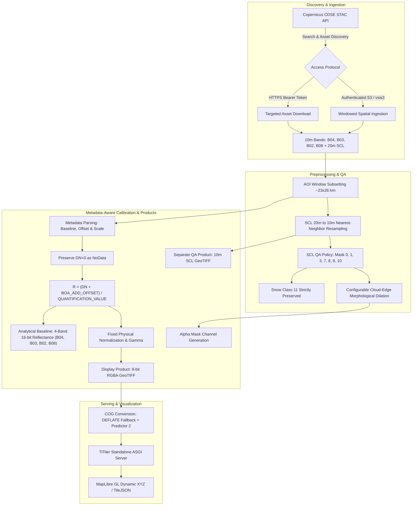

# MemoryLane-Satellite Pipeline Architecture

## 1. Executive Summary

`MemoryLane-Satellite` is an independent, self-hosted, zero-cost satellite imagery pipeline designed to query, ingest, process, and serve Sentinel-2 L2A multispectral imagery as Cloud Optimized GeoTIFFs (COG) to MapLibre-based frontends.

The pipeline is completely decoupled from any commercial APIs (e.g., Google Earth Engine commercial tier, Sentinel Hub paid subscriptions, Planet, Mapbox satellite). It operates using open data from the European Space Agency's Copernicus programme via the Copernicus Data Space Ecosystem (CDSE) and open-source geospatial software.



---

## 2. Target Area of Interest (AOI): Manali–Solang Valley

* **Geographic Extent:** Himachal Pradesh, Western Himalayas, India.
* **Bounding Box (BBOX):** `[77.05, 32.15, 77.30, 32.38]` (WGS84 EPSG:4326).
* **Physical Ground Dimensions:**
  * **Longitude Extent:** $77.30^\circ - 77.05^\circ = 0.25^\circ \approx 23.5\text{ km}$ at latitude $32.25^\circ\text{N}$.
  * **Latitude Extent:** $32.38^\circ - 32.15^\circ = 0.23^\circ \approx 25.5\text{ km}$.
  * **Total Ground Footprint:** Approximately **$23\text{ km} \times 26\text{ km}$** (~600 $\text{km}^2$) covering Manali town, Solang Valley, Rohtang foothills, and the Upper Beas watershed.
* **Projected CRS:** Universal Transverse Mercator (UTM) Zone 43N (`EPSG:32643`).
* **Himalayan Terrain Strategy:**
  * **Steep Mountain Topography:** Deep valley shadows are retained using SCL class 2 (`DARK_AREA_PIXELS`) rather than being masked as clouds.
  * **Snow vs. Cloud Discrimination:** High-altitude ridges feature perennial or seasonal snow and glaciers. Naive thresholding misclassifies snow as clouds. Sentinel-2 L2A's Scene Classification Layer (SCL) explicitly separates snow (class 11) from clouds (classes 8, 9, 10).
  * **Configurable Cloud & Quality Masking:** Mask classes 0, 1, 3, 7, 8, 9, 10. Class 7 (`UNCLASSIFIED`) is included to filter marginal or ambiguous haze. Class 11 (`SNOW_OR_ICE`) is strictly protected.

---

## 3. Data Ingestion: Copernicus Data Space Ecosystem (CDSE)

### 3.1 STAC Discovery & Endpoints
* **STAC Root URL:** `https://stac.dataspace.copernicus.eu/v1`
* **STAC Search:** `POST https://stac.dataspace.copernicus.eu/v1/search`
* **Collection:** `sentinel-2-l2a`
* **Auth Endpoint (OIDC):** `https://identity.dataspace.copernicus.eu/auth/realms/CDSE/protocol/openid-connect/token` (`client_id=cdse-public`)

### 3.2 Dual Access Strategy: HTTPS & Authenticated S3
The pipeline supports two authenticated retrieval paths depending on available credentials:

1. **Direct HTTPS Asset Ingestion:**
   * Uses OAuth2 Bearer token generated via user credentials.
   * Downloads only the specific band asset files (`B02`, `B03`, `B04`, `B08`, `SCL`) identified in the STAC response directly to `data/raw/<scene_id>/`.
2. **Authenticated S3 Direct Access (`eodata`):**
   * CDSE maintains an S3-compatible interface at `https://eodata.dataspace.copernicus.eu`.
   * With CDSE S3 Access/Secret keys, the pipeline can leverage `boto3` or GDAL `/vsis3/` virtual filesystem drivers to read **only the spatial window intersecting the AOI** directly from remote cloud storage without downloading full granule band files.

### 3.3 Targeted Band & Layer Ingestion

All 4 reflectance bands share the identical native 10-meter spatial resolution, ensuring no interpolation artifacts across analytical bands:

| Band / Asset Key | Description | Native Spatial Resolution | Spectral Range | Pipeline Purpose |
| :--- | :--- | :--- | :--- | :--- |
| **`B04`** | Red | 10 meters | 665 nm | RGB Composite (Channel 1) & Reflectance Band 1 |
| **`B03`** | Green | 10 meters | 560 nm | RGB Composite (Channel 2) & Reflectance Band 2 |
| **`B02`** | Blue | 10 meters | 490 nm | RGB Composite (Channel 3) & Reflectance Band 3 |
| **`B08`** | Near Infrared (NIR) | 10 meters | 842 nm | Reflectance Band 4 (Vegetation & NDVI Baseline) |
| **`SCL`** | Scene Classification Layer | 20 meters | Discrete Quality Mask | Quality, Shadow, Cloud Masking (Stored as separate QA raster) |

---

## 4. Metadata-Aware Radiometric Calibration

### 4.1 Processing Baseline Awareness & Formula
On January 25, 2022, ESA deployed **Processing Baseline 04.00** for Sentinel-2, introducing a radiometric offset to avoid negative surface reflectance values after atmospheric correction.
To prevent systematic radiometric bias across multi-temporal datasets, the pipeline parses metadata dynamically:

$$R = \begin{cases} \text{NoData}, & \text{if } DN = 0 \\ \dfrac{DN + \text{BOA\_ADD\_OFFSET}}{\text{QUANTIFICATION\_VALUE}}, & \text{if } DN > 0 \end{cases}$$

Where parameters vary by processing baseline:
* **Baseline < 04.00 (Pre-Jan 25, 2022):**
  * `QUANTIFICATION_VALUE = 10000.0`
  * `BOA_ADD_OFFSET = 0.0`
* **Baseline $\ge$ 04.00 (Post-Jan 25, 2022, including PB 05.xx):**
  * `QUANTIFICATION_VALUE = 10000.0`
  * `BOA_ADD_OFFSET = -1000.0` (band-specific offsets extracted from STAC item `properties` or granule `MTD_TL.xml`)

*Crucial Rule:* Pixel value $DN = 0$ is strictly preserved as NoData and must never have the offset applied.

---

## 5. Preprocessing & Cloud-Quality Masking Policy

### 5.1 SCL Resampling & Classification Rules
The 20m Scene Classification Layer is upsampled to 10m resolution using **nearest-neighbor interpolation** to align with the 10m grid without introducing blended class indices:

| SCL Value | Class Name | Pipeline Action | Rationale |
| :---: | :--- | :--- | :--- |
| **0** | `NO_DATA` | **Masked** (Alpha = 0) | Granule edge / nodata fill |
| **1** | `SATURATED_OR_DEFECTIVE` | **Masked** (Alpha = 0) | Sensor saturation artifacts |
| **2** | `DARK_AREA_PIXELS` | Retained | Mountain shadows (preserved to avoid terrain holes) |
| **3** | `CLOUD_SHADOWS` | **Masked** (Alpha = 0) | Cloud ground shadows |
| **4** | `VEGETATION` | Retained | Forests and meadows |
| **5** | `NOT_VEGETATED` | Retained | Bare rock, moraine, scree |
| **6** | `WATER` | Retained | Rivers and alpine lakes |
| **7** | `UNCLASSIFIED` | **Masked** (Configurable) | Ambiguous / poor quality pixels |
| **8** | `CLOUD_MEDIUM_PROBABILITY` | **Masked** (Alpha = 0) | Cloud cover |
| **9** | `CLOUD_HIGH_PROBABILITY` | **Masked** (Alpha = 0) | Dense cloud cover |
| **10** | `THIN_CIRRUS` | **Masked** (Alpha = 0) | High cirrus ice clouds |
| **11** | `SNOW_OR_ICE` | **PRESERVED** | Glaciers and snowy peaks in Solang Valley |

### 5.2 Configurable Cloud-Edge Morphological Buffering
Cloud perimeters exhibit subtle penumbra that thresholding can miss:
1. An invalid mask is formed: $M_{\text{cloud}} = (SCL \in \{0, 1, 3, 7, 8, 9, 10\})$.
2. Morphological dilation is applied using a circular kernel of radius $r$ (default: 30m = 3 pixels on a 10m grid):
   $$M_{\text{buffered}} = M_{\text{cloud}} \oplus B_r$$
3. Snow/ice pixels ($SCL = 11$) are protected to prevent eroding alpine snow edges:
   $$M_{\text{final}} = M_{\text{buffered}} \land (SCL \neq 11)$$

---

## 6. Output Products & Multi-Temporal Normalization

The pipeline produces three cleanly separated products:

### 6.1 Analytical Product: 4-Band Reflectance GeoTIFF
* **File:** `data/processed/<scene_id>_reflectance.tif`
* **Format:** 4-band 16-bit unsigned integer (`uint16`) GeoTIFF.
* **Bands:** 1: B04 (Red), 2: B03 (Green), 3: B02 (Blue), 4: B08 (NIR) — all 10m native.
* **Pixel Values:** Scaled Surface Reflectance ($DN = R \times 10000$), preserving $0$ as NoData.
* **Purpose:** High-precision input for NDVI, NDWI, NDSI, and temporal change analytics.

### 6.2 QA Product: SCL Classification GeoTIFF
* **File:** `data/processed/<scene_id>_scl.tif`
* **Format:** 1-band 8-bit unsigned integer (`uint8`) GeoTIFF.
* **Resolution:** 10 meters (nearest-neighbor resampled).
* **Purpose:** Audit trail for quality assessment and custom post-filtering.

### 6.3 Display Product: Multi-Temporal Fixed Normalized RGBA
* **Multi-temporal Consistency:** To avoid inter-scene brightness flashing, pixel reflectance $R$ is scaled using fixed physical reference bounds rather than scene-specific percentiles:
  $$R_{\min} = 0.01,\quad R_{\max} = 0.32,\quad \gamma = 1.15$$
  $$\tilde{R} = \text{clip}\left(\frac{R - R_{\min}}{R_{\max} - R_{\min}}, 0.0, 1.0\right)$$
  $$RGB_{\text{8-bit}} = \text{round}\left(255 \times \tilde{R}^{1/\gamma}\right)$$
* **Alpha Channel:** Band 4 is an 8-bit mask ($255 = \text{valid}, 0 = \text{masked}$).
* **File:** `data/processed/<scene_id>_rgb_display.tif`

---

## 7. Cloud Optimized GeoTIFF (COG) & Windows Compatibility

* **File:** `cog/<scene_id>_rgb.tif`
* **Tiling:** $512 \times 512$ internal tile structure.
* **Overviews:** Power-of-2 pyramid overviews (2, 4, 8, 16, 32) using `average` resampling.
* **Windows-Verified Compression:** Standardized to **`DEFLATE` with `PREDICTOR=2`** (horizontal predictor). This ensures full compatibility across all Windows GDAL/Rasterio builds without external WebP driver dependencies.

---

## 8. Dynamic Tile Serving (TiTiler) & MapLibre Integration

### 8.1 Standalone ASGI Tile Server (`server/main.py`)
TiTiler runs as a lightweight native FastAPI ASGI service (`uvicorn server.main:app`) without Docker:
* Dynamic XYZ tile endpoint: `http://127.0.0.1:8000/cog/tiles/WebMercatorQuad/{z}/{x}/{y}.png?url=D:/Projects/MemoryLane-Satellite/cog/manali_solang_rgb.tif`
* Dynamic TileJSON endpoint: `http://127.0.0.1:8000/cog/WebMercatorQuad/tilejson.json?url=D:/Projects/MemoryLane-Satellite/cog/manali_solang_rgb.tif`

### 8.2 MapLibre GL JS Client Integration
```javascript
map.addSource('manali-satellite', {
  'type': 'raster',
  'tiles': [
    'http://127.0.0.1:8000/cog/tiles/WebMercatorQuad/{z}/{x}/{y}.png?url=D:/Projects/MemoryLane-Satellite/cog/manali_solang_rgb.tif'
  ],
  'tileSize': 256,
  'bounds': [77.05, 32.15, 77.30, 32.38]
});

map.addLayer({
  'id': 'manali-satellite-layer',
  'type': 'raster',
  'source': 'manali-satellite',
  'paint': { 'raster-opacity': 1.0 }
});
```
