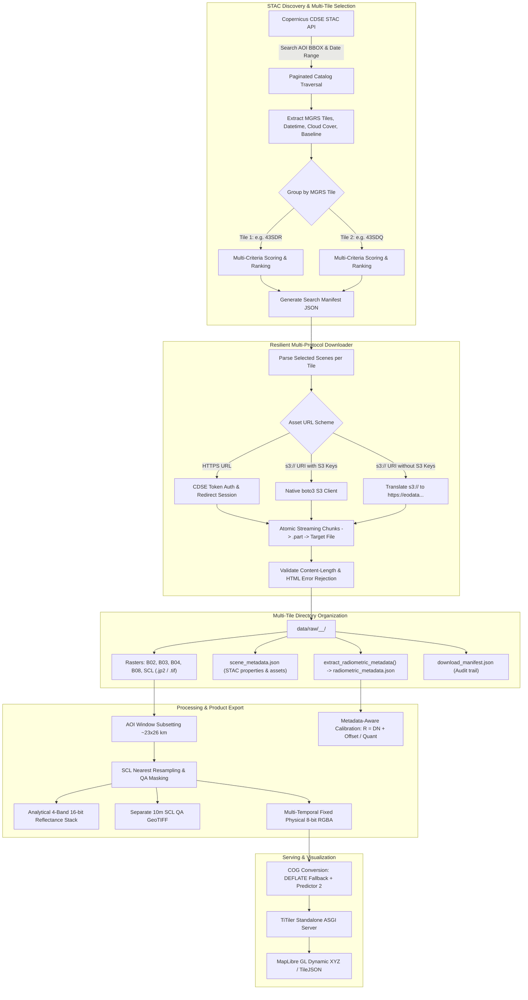

# MemoryLane-Satellite Pipeline Architecture

## 1. Executive Summary

`MemoryLane-Satellite` is an independent, self-hosted, zero-cost satellite imagery pipeline designed to query, ingest, process, and serve Sentinel-2 L2A multispectral imagery as Cloud Optimized GeoTIFFs (COG) to MapLibre-based frontends.

The pipeline is completely decoupled from any commercial APIs (e.g., Google Earth Engine commercial tier, Sentinel Hub paid subscriptions, Planet, Mapbox satellite). It operates using open data from the European Space Agency's Copernicus programme via the Copernicus Data Space Ecosystem (CDSE) and open-source geospatial software.



---

## 2. Target Area of Interest (AOI): Manali–Solang Valley

* **Geographic Extent:** Himachal Pradesh, Western Himalayas, India.
* **Bounding Box (BBOX):** `[77.05, 32.15, 77.30, 32.38]` (WGS84 EPSG:4326).
* **Physical Ground Dimensions:**
  * **Longitude Extent:** $77.30^\circ - 77.05^\circ = 0.25^\circ \approx 23.5\text{ km}$ at latitude $32.25^\circ\text{N}$.
  * **Latitude Extent:** $32.38^\circ - 32.15^\circ = 0.23^\circ \approx 25.5\text{ km}$.
  * **Total Ground Footprint:** Approximately **$23.5\text{ km} \times 25.5\text{ km}$** (~600 $\text{km}^2$).
* **MGRS Tile Geometry & Multi-Tile Intersection:**
  * Through exact STAC footprint polygon intersection, the Manali–Solang AOI is divided between two adjacent UTM Zone 43N tiles:
    * **`43SFR`** (Western half including Solang Valley, Rohtang foothills, Beas river upper basin; covers ~70.98% of AOI).
    * **`43SGR`** (Eastern half including Manali town center, Hampta Pass western approaches; covers ~70.80% of AOI).
  * Neither tile alone provides complete coverage (~71% each); **both tiles are strictly required for 100% AOI coverage**.
  * **Relative Orbit Synchronization:** Relative Orbit **R105** (descending pass at ~05:27 UTC) captures both `43SFR` and `43SGR` within milliseconds in the same satellite swath, ensuring identical atmospheric and solar conditions across the tile boundary. Orbit R005 captures `43SFR` only. Co-temporal selection prioritizes scenes from the shared orbit.
  * **Architecture Mandate:** The pipeline does *not* assume a single Sentinel-2 tile covers the AOI. The discovery engine groups scenes per MGRS tile, ranks the candidates for each tile independently, and downloads each tile into its own dedicated structure.

---

## 3. STAC Scene Discovery & Ranking Engine (`scripts/search_scenes.py`)

### 3.1 Pagination & Catalog Query
* Queries the Copernicus Data Space STAC endpoint: `POST https://stac.dataspace.copernicus.eu/v1/search`
* Traverses all result pages using STAC `next` links until all matching scenes across all intersecting MGRS tiles are captured.
* Extracts core metadata:
  * MGRS Tile ID: parsed from `s2:mgrs_tile`, MGRS extension (`mgrs:utm_zone`, `mgrs:latitude_band`, `mgrs:grid_square`), or granule naming regex (`_T<MGRS>_`).
  * Acquisition Date & Time (`datetime`).
  * Cloud cover percentage (`eo:cloud_cover`).
  * Processing Baseline (`s2:processing_baseline` or `processing:software`).
  * Asset URLs for `B02`, `B03`, `B04`, `B08`, `SCL`, and metadata XML.

### 3.2 Multi-Criteria Scene Ranking
Selecting scenes based solely on minimum `eo:cloud_cover` is flawed in alpine terrain because snow fields are frequently misidentified as clouds, and a scene with 0% cloud cover may be months away from the target date or missing essential bands.
Instead, candidate scenes are ranked per MGRS tile using a composite scoring function:

$$\text{Score} = (\text{CloudCover} \times w_{\text{cloud}}) + (\Delta\text{Days} \times w_{\text{date}}) + (\text{MissingAssets} \times P_{\text{missing}})$$

* Default weights: $w_{\text{cloud}} = 1.0$, $w_{\text{date}} = 0.5$, $P_{\text{missing}} = 1000.0$.
* Lower score indicates higher priority.
* Discovered scenes and per-tile rankings are serialized to `data/search_manifest.json`.

---

## 4. Resilient Asset Acquisition (`scripts/download_sentinel.py`)

### 4.1 Authentication & Token Lifecycle (`CDSEAuth`)
* Connects to CDSE Keycloak: `POST https://identity.dataspace.copernicus.eu/auth/realms/CDSE/protocol/openid-connect/token` (`client_id=cdse-public`).
* Caches JWT access tokens with a 60-second expiration safety buffer.
* Automatically invalidates and refreshes tokens upon receiving HTTP 401 Unauthorized responses.
* Reads credentials strictly from environment variables (`CDSE_USERNAME`, `CDSE_PASSWORD`).

### 4.2 Multi-Protocol Asset Support (HTTPS & S3)
* **HTTPS Downloads:** Uses a custom `CDSEDownloadSession` that preserves `Authorization: Bearer <token>` across CDSE subdomains (`catalogue`, `zipper`, `eodata`).
* **S3 Downloads:**
  * When `CDSE_S3_ACCESS_KEY` and `CDSE_S3_SECRET_KEY` are provided, downloads directly using `boto3.client('s3')` targeting `https://eodata.dataspace.copernicus.eu`.
  * When S3 credentials are absent, seamlessly translates `s3://eodata/<path>` to `https://eodata.dataspace.copernicus.eu/<path>` and streams with Bearer token authentication.

### 4.3 Download Integrity & Atomic Writes
* **Atomic Writes:** Streams chunks (1MB) into a temporary `.part` file. Only upon complete, verified download is the `.part` file renamed to the final filename.
* **Integrity Validation:** Verifies downloaded bytes against `Content-Length` headers and verifies that responses are not HTML error pages disguised as HTTP 200.
* **Exponential Backoff Retries:** Automatically retries transient connection drops and HTTP 429/5xx errors up to 4 times with exponential backoff.
* **Skip Existing:** Skips downloading any asset if a valid, non-empty local file already exists matching the expected size.

---

## 5. Multi-Tile Organization & Metadata Integration

### 5.1 Storage Layout
Each tile acquisition is isolated in its own folder under `data/raw/`:
```
data/raw/<YYYYMMDD>_<MGRS>_<SCENE_ID>/
├── B02.jp2 (or .tif)           # Blue 10m
├── B03.jp2 (or .tif)           # Green 10m
├── B04.jp2 (or .tif)           # Red 10m
├── B08.jp2 (or .tif)           # NIR 10m
├── SCL.jp2 (or .tif)           # Scene Classification Layer 20m
├── MTD_TL.xml                  # Granule metadata XML (if available)
├── scene_metadata.json         # Complete STAC Item properties & asset links
├── radiometric_metadata.json   # Extracted BOA_ADD_OFFSET & QUANTIFICATION_VALUE per band
└── download_manifest.json      # Local file audit record & completion timestamp
```

### 5.2 Metadata Integration
Immediately following tile asset acquisition, the downloader invokes `extract_radiometric_metadata()` from `processing/build_composite.py`, passing the downloaded metadata XML or STAC properties. The resulting per-band calibration parameters (`quantification_value` and `boa_add_offset`) are written to `radiometric_metadata.json`, ensuring downstream composite processing requires zero re-parsing.

---

## 6. Preprocessing & Cloud-Quality Masking Pipeline

### 6.1 SCL Resampling & Classification Rules
The 20m Scene Classification Layer is upsampled to 10m resolution using **nearest-neighbor interpolation** (`resample_scl_nearest()`):

| SCL Value | Class Name | Pipeline Action | Rationale |
| :---: | :--- | :--- | :--- |
| **0** | `NO_DATA` | **Masked** (Alpha = 0) | Granule edge / nodata fill |
| **1** | `SATURATED_OR_DEFECTIVE` | **Masked** (Alpha = 0) | Sensor saturation artifacts |
| **2** | `DARK_AREA_PIXELS` | Retained | Mountain shadows (preserved to avoid terrain holes) |
| **3** | `CLOUD_SHADOWS` | **Masked** (Alpha = 0) | Cloud ground shadows |
| **4** | `VEGETATION` | Retained | Forests and alpine meadows |
| **5** | `NOT_VEGETATED` | Retained | Bare rock, moraine, scree |
| **6** | `WATER` | Retained | Rivers and glacial lakes |
| **7** | `UNCLASSIFIED` | **Masked** (Configurable) | Ambiguous / poor quality pixels |
| **8** | `CLOUD_MEDIUM_PROBABILITY` | **Masked** (Alpha = 0) | Probable cloud cover |
| **9** | `CLOUD_HIGH_PROBABILITY` | **Masked** (Alpha = 0) | Dense cloud cover |
| **10** | `THIN_CIRRUS` | **Masked** (Alpha = 0) | High cirrus ice clouds |
| **11** | `SNOW_OR_ICE` | **PRESERVED** | Glaciers and snowy peaks in Solang Valley |

### 6.2 Cloud-Edge Buffering
Morphological dilation (`scipy.ndimage.binary_dilation` with a 30m / 3-pixel circular kernel) expands invalid cloud boundaries to remove diffuse penumbra while explicitly protecting Class 11 snow pixels from erosion.

---

## 7. Multi-Tile Mosaicking & AOI Grid Alignment (`processing/build_composite.py`)

### 7.1 Snapped AOI Integer Grid (`compute_snapped_aoi_grid`)
To prevent fractional pixel shifts and resampling blur when stitching tiles:
1. The WGS84 AOI bounding box `[77.05, 32.15, 77.30, 32.38]` is projected into UTM Zone 43N (`EPSG:32643`).
2. Boundaries are snapped outwards to exact multiples of the 10.0m spatial resolution using floor/ceil operations:
   * $\text{min\_x} = \lfloor \frac{\text{proj\_min\_x}}{10.0} \rfloor \times 10.0 = 693330.0$
   * $\text{max\_y} = \lceil \frac{\text{proj\_max\_y}}{10.0} \rceil \times 10.0 = 3584890.0$
   * $\text{max\_x} = \lceil \frac{\text{proj\_max\_x}}{10.0} \rceil \times 10.0 = 716380.0$
   * $\text{min\_y} = \lfloor \frac{\text{proj\_min\_y}}{10.0} \rfloor \times 10.0 = 3558900.0$
3. The resulting unified raster shape is exactly **$2305 \text{ pixels (width)} \times 2599 \text{ pixels (height)}$**, covering a true ground area of $23.05\text{ km} \times 25.99\text{ km}$.

### 7.2 Radiometric Calibration & Hole-Filling Overlap Blending (`mosaic_tile_datasets`)
1. **Per-Tile Reprojection:** Each input tile (`43SFR`, `43SGR`) is warped to the common target grid. Bilinear interpolation is used for spectral reflectance bands (B02, B03, B04, B08) and nearest-neighbor for SCL.
2. **Metadata-Aware Calibration:** Before blending, raw DNs are calibrated to physical Bottom-Of-Atmosphere reflectance using each tile's specific radiometric metadata:
   $$R = \frac{DN + \text{BOA\_ADD\_OFFSET}}{\text{QUANTIFICATION\_VALUE}}$$
3. **Cloud Masking & Dilation:** Cloud, cirrus, shadow, and unclassified pixels are identified per tile and dilated by 30m, strictly preserving Snow/Ice (Class 11).
4. **Seamless Overlap Blending:**
   * **Dual Valid:** Where both tiles have clear, valid terrain pixels in the overlap corridor, the calibrated BOA reflectance values are blended as an unweighted average, preventing abrupt boundary steps.
   * **Hole-Filling:** If Tile A is occluded by a localized cloud/shadow or nodata, but Tile B has clear ground, Tile B's reflectance is used seamlessly.
   * **Dual Invalid:** Pixels marked invalid across all tiles are designated as nodata with Alpha = 0.

### 7.3 Natural Color RGB Synthesis with Soft-Knee Shoulder (`enhance_natural_color_rgb`)
Direct linear stretching of Sentinel-2 bands produces severe visual defects in alpine regions: blown-out white blobs on snowfields/glaciers and fluorescent "toxic" greens in valleys. The pipeline uses a high-fidelity visual synthesis model:

1. **Dark-Object Baseline Subtraction:**
   Subtracted per-band haze baselines: $R_{\min} = [0.010, 0.012, 0.015]$ for Red, Green, and Blue.
2. **Soft-Knee Highlight Compression:**
   * For reflectance up to $R_{\text{knee}} = 0.28$: A linear tone stretch is mapped up to 70% dynamic range (0.70).
   * For high-reflectance snow and ice ($R > 0.28$ up to $R_{\max} = 0.85$): An asymptotic exponential shoulder compresses values into the upper 30% of the dynamic range:
     $$\text{Value} = 0.70 + 0.30 \times \left(1 - \exp\left(-2.5 \times \frac{R - R_{\text{knee}}}{R_{\max} - R_{\text{knee}}}\right)\right)$$
   This prevents saturation at 255 and retains visible mountain contours, ridges, and crevasse textures.
3. **Vegetation Balance:** A subtle dampening factor (0.96) is applied to the Green band to align visual appearance with human eye perception.
4. **Perceptual Gamma:** Non-linear $\gamma = 1.15$ enhancement produces balanced contrast across dark alpine pine forests and bright valley floors.
5. **Alpha Mask:** Valid pixels receive Alpha = 255; cloud-masked, invalid, or out-of-bounds pixels receive Alpha = 0.

---

## 8. Decoupled Product Exports & COG Serving

### 8.1 Product Exports
The mosaic pipeline produces three decoupled, non-destructive deliverables:
1. **Analytical Reflectance Baseline (`data/processed/manali_solang_reflectance.tif`):**
   * 4 bands: B04 (Red), B03 (Green), B02 (Blue), B08 (NIR).
   * Format: `uint16` with physical scale factor $10000$ ($DN = R \times 10000$). NoData = 0.
   * Preserves scientific BOA reflectance values for analytical, vegetation (NDVI), and snow index (NDSI) calculations.
2. **Consensus SCL QA Raster (`data/processed/manali_solang_scl.tif`):**
   * 1 band `uint8` categorical classification layer at 10m.
   * Preserves classification flags (snow, vegetation, rock, water, clouds).
3. **Display RGBA Product (`data/processed/manali_solang_rgb_display.tif`):**
   * 4 channels (Red, Green, Blue, Alpha) in `uint8`.
   * Formatted for direct display and tiling.

### 8.2 Cloud Optimized GeoTIFF Generation (`processing/create_cog.py`)
Both the analytical and display rasters are converted to Cloud Optimized GeoTIFFs using `rio-cogeo`:
* **Internal Tiling:** $512 \times 512$ pixel blocks.
* **Overviews:** Power-of-2 reduced-resolution pyramids (levels 2, 4, 8, 16, 32) generated using `average` resampling for continuous imagery and `nearest` for categorical SCL.
* **Compression:** `DEFLATE` with `PREDICTOR=2` (horizontal differencing), offering 100% native Windows compatibility without requiring external C libraries (such as WebP).
* **Validation:** Automated programmatic verification with `rio_cogeo.cogeo.cog_validate()`.

### 8.3 Dynamic Tile Serving (`server/main.py`)
A lightweight, standalone FastAPI/TiTiler ASGI application serves the generated COG:
* Exposes standard Slippy Map XYZ raster tile endpoints: `/tiles/{z}/{x}/{y}.png`.
* Exposes TileJSON metadata endpoint for direct consumption by MapLibre GL JS / Leaflet.
* Zero Docker dependency; runs natively via Python `uvicorn`.
